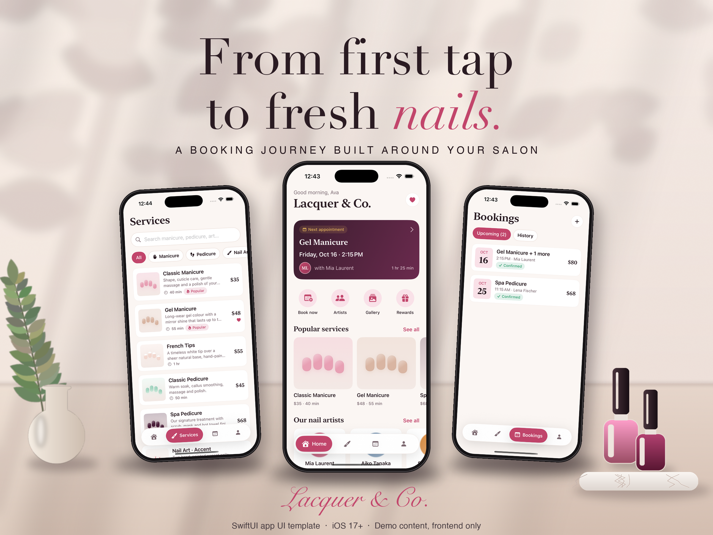
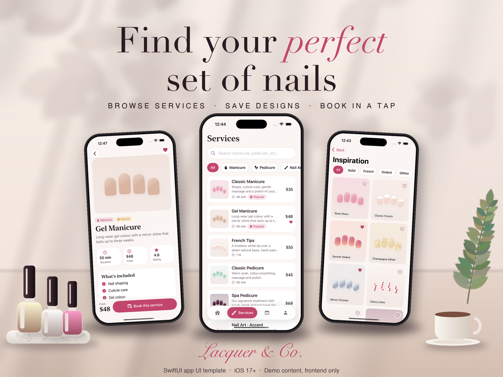
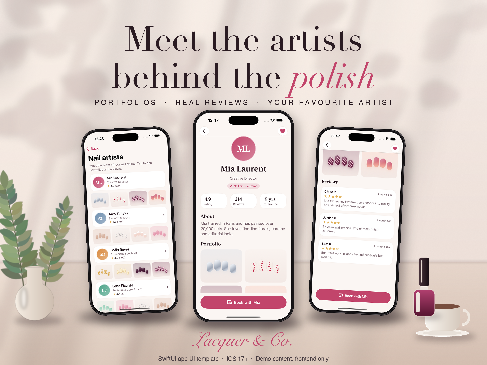
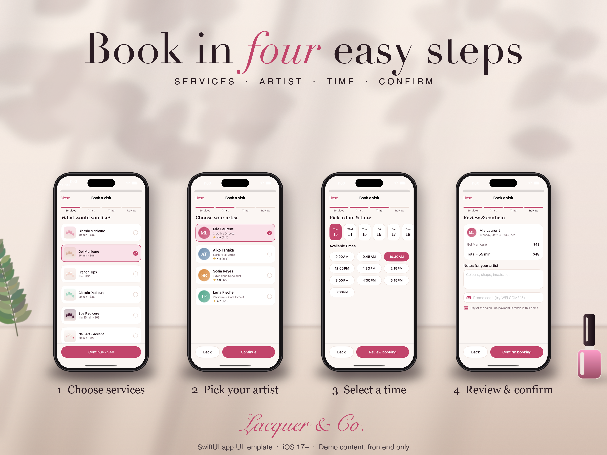
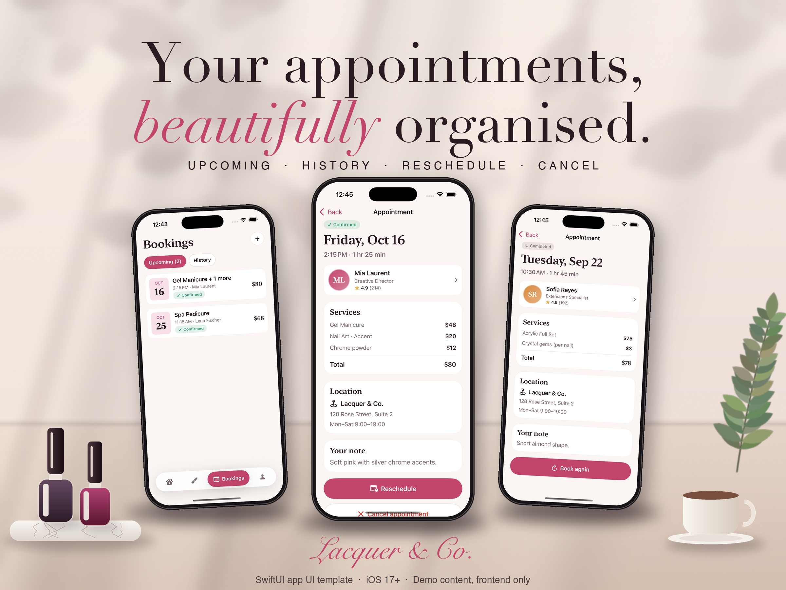
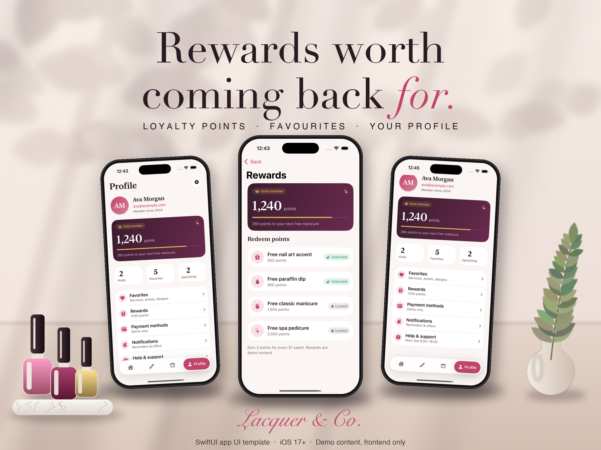
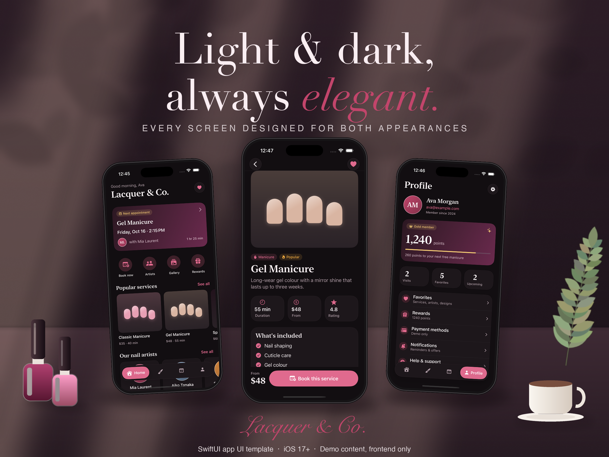

# Lacquer – Nail Salon Booking App (SwiftUI UI Template)

A complete **SwiftUI** UI template for a nail salon / beauty booking app. iOS 17+, light & dark mode.

**Get the source code: [LINK]**

## What's included
- Onboarding, Home, Services with search and filters, Service detail
- Nail artists with portfolios and reviews, inspiration gallery
- 4-step booking flow: services + add-ons, artist, date & time, review, success
- Bookings (upcoming / history), appointment detail, reschedule and cancel
- Profile, favorites, rewards, settings (theme, haptics, notifications)
- Reusable components, a light/dark design system, empty states, unit tests
- Full documentation: quick start, customization, screen overview, license notes

## Please note
This is a **UI template only**. There is no real backend, login, database or payments. Availability, bookings and rewards are demo content stored in memory – plug in your own backend. Requires Xcode 16+ and iOS 17+.

## More previews

## Screenshots

### Onboarding

### Home

### Services

### Service detail

### Artists & gallery

### Booking flow

### Bookings

### Profile, favorites, rewards & settings

### Dark mode

**Get the source code: [LINK]**
